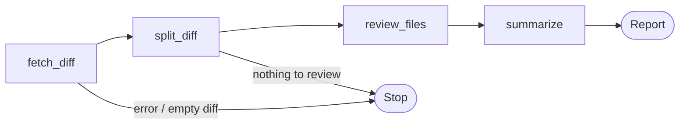

# 🤖 AI Code Review Assistant

An AI-powered code reviewer built with **LangGraph** and **Groq**. Give it a GitHub Pull Request link (or a diff file) and it returns a Markdown report with **review comments, risk flags, and concrete suggestions**, file by file.

## ✨ Features

- 🔗 Reviews any public GitHub PR from just its URL (private repos work with a token)
- 📄 Also accepts a local `.diff` / `.patch` file, or a diff piped through stdin
- 🧩 Reviews each changed file separately, so big PRs stay accurate
- 🚦 Gives an overall risk level: 🟢 low, 🟡 medium, 🔴 high
- ⚠️ Flags problems such as SQL injection, hardcoded secrets, missing tests, and breaking changes
- 💡 Every comment includes a suggested fix
- 💾 Saves the report to a Markdown file with `--out`

## 🧠 How It Works

The tool is a LangGraph workflow. A shared state moves from one node to the next:



| Node | What it does |
|---|---|
| `fetch_diff` | Gets the diff from a GitHub PR URL, a file, or stdin |
| `split_diff` | Splits the diff into one chunk per file and skips lock files and images |
| `review_files` | Sends each chunk to a Groq LLM and gets back structured comments and risk flags |
| `summarize` | Picks the highest risk level, writes a PR summary, and builds the Markdown report |

If fetching fails or there is nothing to review, a conditional edge ends the run early with a clear error.

## 📦 Installation

**Requirements:** Python 3.10+ and a [Groq API key](https://console.groq.com/keys).

```bash
git clone https://github.com/YOUR_USERNAME/YOUR_REPO.git
cd YOUR_REPO

python -m venv .venv
# Windows (PowerShell):
.venv\Scripts\Activate.ps1
# macOS / Linux:
source .venv/bin/activate

pip install -r requirements.txt
```

## 🔑 Configuration

Copy `.env.example` to `.env` and fill it in:

```env
GROQ_API_KEY=your_groq_api_key_here

# Optional: only needed for private repos or to avoid GitHub rate limits
GITHUB_TOKEN=

# Optional: pick the Groq model (model names change, check console.groq.com/docs/models)
GROQ_MODEL=openai/gpt-oss-120b
```

> ⚠️ **Never commit your `.env` file.** Make sure `.gitignore` contains `.env`.

## 🚀 Usage

```bash
# Review a GitHub Pull Request
python app.py https://github.com/owner/repo/pull/123

# Review a local diff and save the report
git diff main > my.diff
python app.py my.diff --out review.md

# Pipe a diff in
git diff | python app.py -
```

## 📋 Example Output

```markdown
# 🤖 AI Code Review

**Overall risk:** 🔴 HIGH

## ⚠️ Risk flags
- SQL injection
- hardcoded secret

### `check.py`  🔴 high
- 🔴 HIGH — `API_KEY = "sk-12345-secret"`
  - Issue: Hardcoded API key is a security risk.
  - Suggestion: Load the key from an environment variable.
```

## 📁 Project Structure

```
.
├── app.py             # LangGraph code review agent + CLI
├── requirements.txt   # Python dependencies
├── .env.example       # Example environment variables
└── README.md
```

## ⚠️ Limitations

- **AI can be wrong.** Always check the suggestions before applying them.
- Very large files are truncated (about 12,000 characters per file) to stay within model limits.
- Lock files, minified files, and images are skipped.
- Review quality depends on the Groq model you choose.

## 🗺️ Roadmap

- [ ] `--post` option to comment the review directly on the PR
- [ ] GitHub Action to review every new PR automatically
- [ ] Parallel security and test-coverage review nodes
- [ ] A verification step that double-checks the AI's suggestions
- [ ] Streamlit web interface

## 🛠️ Built With

- [LangGraph](https://github.com/langchain-ai/langgraph): workflow orchestration
- [LangChain Groq](https://python.langchain.com/docs/integrations/chat/groq/): LLM connection
- [Groq](https://groq.com/): fast LLM inference
- [Pydantic](https://docs.pydantic.dev/): structured output

## 📄 License

MIT License. Feel free to use and improve it.
